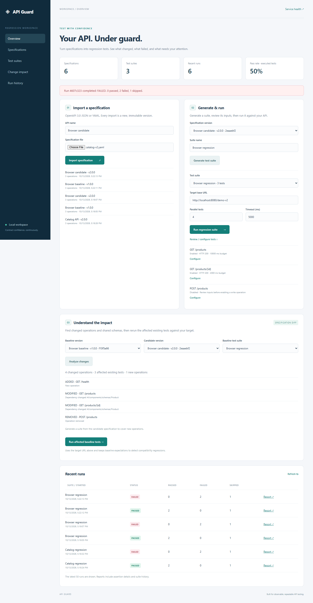

# API Guard

**Automated API regression and contract testing with change-impact analysis.**

Import an OpenAPI specification, generate a suite, run it against an API, and inspect failures in an HTML report. Compare two specification versions to identify the existing tests affected by an API change.

Java 17+ · Spring Boot · REST Assured · JUnit 5 · H2 / Flyway · Thymeleaf



## What it does

- Imports OpenAPI **3.0.x** JSON/YAML as immutable versions, validates documents, and resolves local references.
- Generates one editable success-path test per operation, including example request inputs and response schemas.
- Checks HTTP status, JSON response schema, content type, documented header presence, configured header values, JSON pointer equality, and latency.
- Runs suites asynchronously with bounded parallelism, per-request configuration, queue limits, and connection/read timeouts.
- Persists suites, run summaries, and assertion results. Renders printable, self-contained HTML reports with recent suite history.
- Detects added, removed, and modified operations, including changes to referenced schemas, parameters, request bodies, responses, and security schemes.
- Reruns impacted **baseline tests** against a candidate API, preserving old expectations to reveal compatibility regressions.
- Includes a browser dashboard, deterministic demo API, Maven wrapper, Docker Compose, and GitHub Actions verification.

## Quick start

Requirements: JDK 17 or newer. Maven is downloaded by the wrapper on first use. Python 3 is optional for the automated demo.

```powershell
# Windows PowerShell
./mvnw.cmd verify
./scripts/start.ps1 -Demo
```

The PowerShell launcher can discover a JDK under `%USERPROFILE%/.jdks` when `JAVA_HOME` is unset. If Maven cannot find Java, set `JAVA_HOME` to your JDK directory first.

```bash
# macOS / Linux
bash ./mvnw verify
java -jar target/api-regression-platform-1.0.0.jar --spring.profiles.active=demo
```

Open **http://localhost:8080**. The database is created under `data/` and survives restarts. Run the demo in another terminal:

```bash
python scripts/demo.py
```

The demo imports both catalog specifications, generates a suite, adds header/data assertions, runs a passing baseline, and detects two failures after `name` is renamed to `title`. It saves HTML reports and the impact JSON under `reports/` (ignored by Git). A POST test stays disabled pending review; a new health operation is listed separately because it has no existing baseline test.

### Try it in the dashboard

1. Import `examples/catalog-v1.yaml`, then generate a suite.
2. Review test configurations. Run against `http://localhost:8080/demo-api`.
3. Import `examples/catalog-v2.yaml`.
4. Select v1 as baseline, v2 as candidate, and the v1 suite. Analyze changes.
5. Change the target to `http://localhost:8080/demo-v2`, then run affected baseline tests.
6. Open the failing report to inspect schema, header, and data checks.

The demo endpoints are enabled only with the `demo` Spring profile. Rebuild after source changes; the PowerShell launcher builds only when the packaged JAR is absent.

## Docker

```bash
docker compose up --build
```

Open the same dashboard at localhost:8080. Compose enables the demo profile and stores the database in a named volume. To test an API running on the Docker host, use `http://host.docker.internal:PORT`. Inside the container, `localhost` refers to the container itself. The image build runs the test suite.

## Configure a test

Use **Review / configure tests** in the dashboard or replace a test's config using:

```http
PUT /api/suites/{suiteId}/tests/{testId}
Content-Type: application/json

{
  "enabled": true,
  "disabledReason": "",
  "pathParams": {"id": "1"},
  "queryParams": {},
  "requestHeaders": {},
  "requestBody": null,
  "expectedHeaders": {"X-API-Version": "1"},
  "assertions": [{"pointer": "/name", "expected": "Mechanical keyboard"}],
  "maxLatencyMs": 2000
}
```

Assertions use **JSON Pointer**, not JSONPath (`/items/0/id`, not `$.items[0].id`). The suite's response contract comes from its immutable specification version. To adopt new expectations, generate a new suite from the candidate version.

## Configuration

| Setting | Default | Purpose |
| --- | --- | --- |
| `PORT` | `8080` | HTTP listener port |
| `SERVER_ADDRESS` | `127.0.0.1` | Listener address; container overrides to `0.0.0.0` |
| `API_ALLOWED_HOSTS` | `localhost,127.0.0.1` | Comma-separated exact target hostnames |
| `DATABASE_URL` | `jdbc:h2:file:./data/apiguard;DB_CLOSE_ON_EXIT=FALSE` | H2 JDBC URL |
| `DATABASE_USER` | `sa` | Database user |
| `DATABASE_PASSWORD` | empty | Database password |
| `platform.workers` | `8` | Global request worker limit |
| `platform.max-concurrent-runs` | `2` | Simultaneous run coordinators |
| `platform.queue-capacity` | `32` | Waiting run limit |

Set the allowlist before testing another host. Redirects are not followed. Authentication headers can be supplied per test. This is a **local, single-user application**: it has no login or tenant isolation, and suite inputs are stored in the local database. Keep it on a trusted interface; add authentication and secret management before shared deployment.

## Verification

```bash
bash ./mvnw verify
```

JUnit 5 tests exercise the actual Spring HTTP API, a local target server, response validation failures, reference handling, change impact, HTML escaping, restart recovery, and concurrent request isolation. They do not call public APIs. Test results are under `target/surefire-reports/`; JaCoCo HTML coverage is at `target/site/jacoco/index.html`. GitHub Actions runs the same verification on pushes to `main` and pull requests.

For the optional browser smoke test, install `playwright` with `python -m pip install playwright`, have Google Chrome installed, start the demo profile, and run `python scripts/browser-smoke.py`. It exercises imports, configuration editing, successful and failing runs, impact analysis, reports, and mobile layout; screenshots go into `reports/`. Format Java with `./mvnw.cmd spotless:apply` (or `bash ./mvnw spotless:apply`).

## Scope and limitations

- OpenAPI 3.0 only; bundle external `$ref` files before importing. OpenAPI 3.1, Swagger 2, callbacks, links, and server-variable expansion are not implemented.
- Generated cases are success-path smoke tests, not exhaustive business scenarios. They select the lowest explicit 2xx response. Supply domain-specific fixtures and assertions for meaningful regression coverage.
- GET, HEAD, and OPTIONS are enabled by default when supported. Write operations, authentication requirements, and unsupported inputs require review. All documented response headers are treated as required by this platform's policy.
- Request support is scalar path/query/header parameters and JSON bodies; multipart, cookies, complex parameter serialization, and OAuth token acquisition are not automated.
- Response schemas use a Draft 7 validator with OpenAPI nullable/exclusive-bound conversion. Discriminator routing, read/write-only required-field semantics, and format validation are not fully modeled. Non-JSON responses require manual tooling.
- Specification diffing is conservative: documentation-only changes can mark an operation affected. It is not a formal breaking-change classifier and cannot discover undocumented implementation changes without executing tests.
- Added operations need a new candidate suite; an impacted rerun includes only existing baseline tests. Disabled tests remain skipped.
- Runs use a single application process and H2. There is no distributed queue, cancellation endpoint, scheduled execution, or test dependency ordering. Parallel tests must be independent. A restart marks unfinished runs interrupted.
- Timeouts bound connection and socket-read waits, not an absolute end-to-end deadline for indefinitely streaming responses. Latency measures the entire client request, including setup; it is a regression threshold, not a load-test benchmark.
- Reports omit raw response bodies and request headers. Suite configuration and imported examples can still contain sensitive data; do not commit local databases or secret fixtures.

See [API reference](docs/API.md), [architecture](docs/ARCHITECTURE.md), [verification notes](docs/VERIFICATION.md), and [commit guide](docs/COMMIT_PLAN.md).
