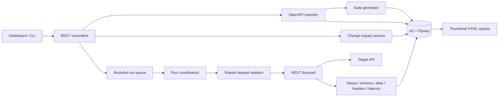

# Architecture

API Guard is a single Spring Boot process with a local H2 database. The dashboard calls the same REST API available to scripts. REST Assured is the runtime HTTP client; JUnit 5 verifies the platform and its execution behavior.

## Import and generation

`SpecEngine` reads YAML or JSON into a constrained Jackson tree, rejects external references, validates through Swagger Parser with remote resolution disabled, and persists the original document. Operations are normalized by combining path and operation parameters and inheriting global security. Every imported version has its own UUID; the user-provided API name and OpenAPI `info.version` are display metadata.

`SuiteService` generates a test for each operation. It selects the lowest explicit 2xx response, picks JSON content, copies documented header names, and creates request samples from examples, defaults, enums, or simple type placeholders. Unsupported cases and write operations remain disabled. Tests reference local schema components rather than infinitely expanding recursive definitions. OpenAPI nullable and exclusive-bound keywords are translated for the Draft 7 schema validator.

This generation is deliberately a starting point. Real fixture identifiers, authentication headers, negative cases, workflow dependencies, and domain assertions require developer input.

## Run lifecycle and concurrency

`RunService` validates the explicit target URL and selects a snapshot of test definitions before enqueueing a run. A fixed number of coordinators consume a bounded queue. Each coordinator submits at most the requested parallelism to a shared worker pool, replenishing tasks as completed results arrive. Thus each run has a concurrency ceiling, and all runs together share the global worker ceiling.

`RegressionExecutor` creates a fresh REST Assured request builder and config for each test. It never mutates REST Assured's global settings. Connection/read timeouts and disabled redirects are applied per request. A failed check yields FAILED; a request exception yields ERROR. Later tests continue after either outcome.

Each result is inserted immediately. Summary counts are computed at completion. Startup recovery marks unfinished database runs INTERRUPTED. The in-memory queue is not replayed after restart. Run history stores the specification ID, target, summary, results, and timestamps; request configuration snapshots are held in memory for execution and are not retained as historical credential-bearing payloads.

## Change-impact algorithm

1. Index baseline and candidate operations by HTTP method and path.
2. Compute the union of operation keys to find additions and removals.
3. For each common operation, compare normalized operation trees and their transitive local-reference dependencies. Include referenced security schemes even though their names are not `$ref` values.
4. Report differing operation fields and reference pointers as reasons. Circular references are tracked with a visited set.
5. Map changed or removed operation keys to existing test IDs in the baseline suite. Keep added operations separate.

The comparison is structural and conservative. JSON object order is ignored; array order and descriptive metadata are not. A change to an unused component does not affect tests. Changes to `info.version` alone do not affect tests. Server metadata participates in diffs, but execution always uses the user's explicit base URL.

Impacted reruns preserve the baseline contract: silently regenerating expectations from a changed specification would hide compatibility regressions. Generate a candidate suite separately when intentionally accepting the new contract.

## Persistence and reports

Flyway owns the relational schema. Specifications, suites, and runs store versioned JSON payloads in CLOB columns with indexed lookup metadata. Test results have a compound `(run_id, test_id)` key. SQL values are bound parameters; table identifiers are internal constants.

Reports render escaped text through Thymeleaf. They include failed checks, elapsed times, error categories, and the most recent 20 runs for that suite. Raw response bodies and authentication headers are not persisted in result records. Suite inputs themselves are local database data and can contain credentials.

## Deployment boundary

This implementation is for a trusted local workspace. It binds to loopback by default, allows exact target hosts, and avoids remote `$ref` fetching. It does not implement user authentication, tenant separation, encrypted secret storage, multi-node coordination, or a hardened network sandbox. Docker Compose publishes only the host loopback port.

Tests use in-memory H2 and loopback HTTP servers. Container builds and CI run Maven verification; no public target API is needed for tests.
