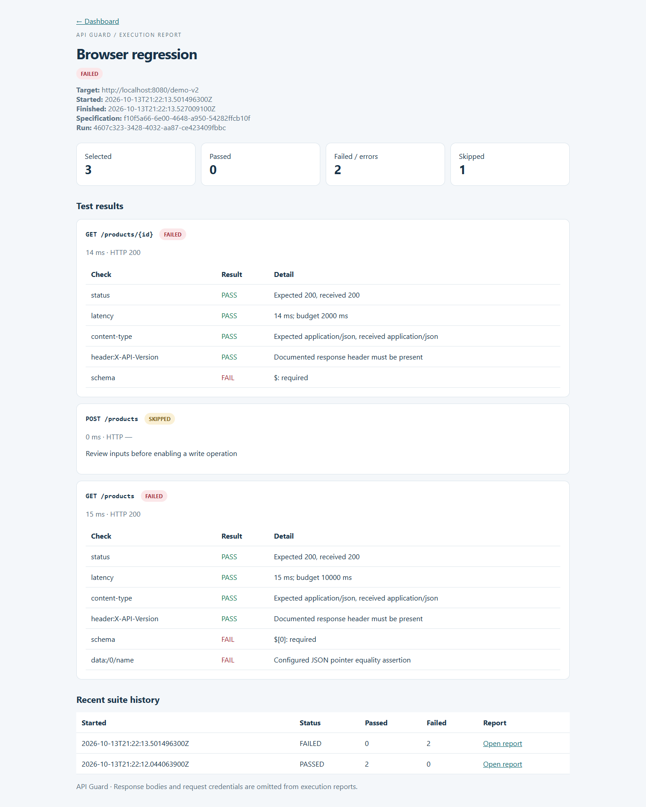

# Local verification

Verified on Windows with Java 17 and Maven Wrapper 3.9.11. This records actual local checks; it does not claim a hosted CI or container run.

| Check | Result |
| --- | --- |
| Maven `verify` | Passed; runnable Spring Boot JAR generated |
| PlatformIntegrationTest | 10 passed |
| RegressionExecutorTest | 9 passed |
| RunServiceTest | 3 passed |
| SpecEngineTest | 4 passed |
| Total JUnit tests | **26 passed, 0 failures, 0 errors** |
| Python HTTP demo | Passed; baseline PASSED, changed contract FAILED as intended |
| Chrome browser smoke | Passed; desktop workflow, invalid editor input, report rendering, mobile layout |
| JavaScript syntax | Passed via `node --check` |
| Docker Compose configuration | Passed via `docker compose config --quiet` |
| Docker image build / container execution | Not run; local Docker engine was stopped |
| GitHub Actions | Workflow supplied; not executed on GitHub |

The browser checks ran against the packaged application. The application was restarted during verification and retained earlier specification versions, suites, and run history in its file-backed database.

## Important assertions exercised

- Imports and validates specifications through the actual HTTP API.
- Generates path parameters and keeps writes disabled until explicitly enabled.
- Executes an explicitly enabled POST and validates its 201 response.
- Separately reports status, schema, header, JSON data, latency, invalid JSON, and timeout failures.
- Does not follow target redirects.
- Keeps request headers isolated across parallel requests.
- Enforces both per-run and global worker limits and rejects queue overflow without losing accepted runs.
- Detects transitive schema dependencies and ignores unused component changes.
- Keeps baseline expectations during impacted reruns and rejects empty selections.
- Resolves recursive local schemas and translates nullable/exclusive bounds.
- Marks unfinished runs interrupted during startup recovery.
- Escapes user-controlled text in HTML reports.

Generated artifacts are ignored by Git: `target/surefire-reports/`, `target/site/jacoco/`, `reports/`, and `data/`. The screenshots below contain only local demo data.

